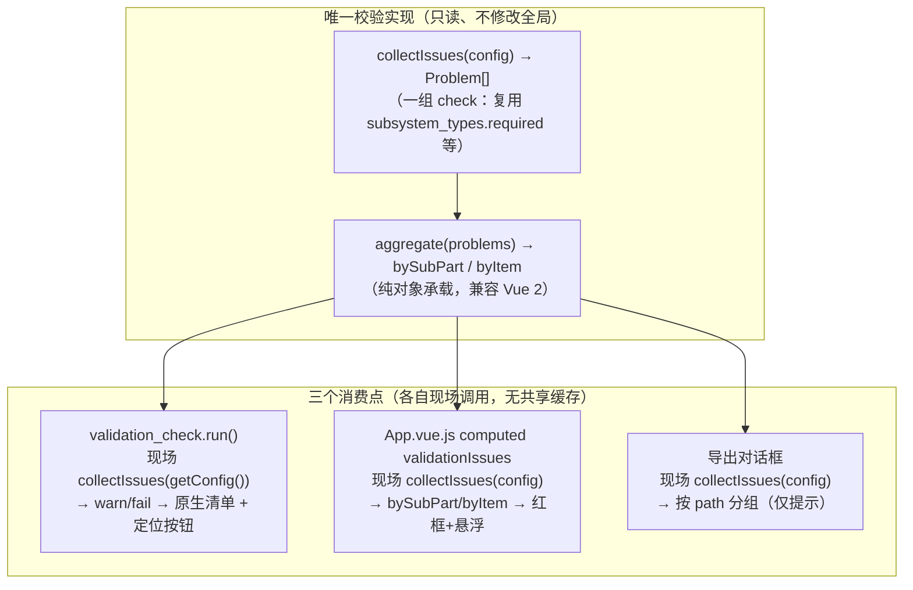

# 校验与错误提示重构实现计划（Validation & Problem Reporting Refactor）

> 状态：**待审阅（已按评审修订）** · 日期：2026-08-26 · 范围：`src/` 前端插件（不含主模组 MachineMax）
> 目标版本：v0.4.0 之后的批次 · 参照：本仓库 [docs/01-总体设计.md](./01-总体设计.md) / [docs/重构计划.md](./重构计划.md)

---

## 1. 背景与目标

插件经过多轮迭代，当前的**校验 / 警告/错误提示**逻辑非常散乱，且缺少结构化数据。主要表现为：

| # | 问题 | 现状 |
|---|------|------|
| A | 唯一集中校验入口返回非结构化数据 | [mode/validation.js](file:///d:/Files/Project_MinecraftMods/Machine-Max_BlockbenchPlugin/src/mode/validation.js) 的 `runValidation(config)` 返回 **`string[]` 纯字符串数组**，无严重级别、无指向具体元素的路径、无定位动作 |
| B | 校验与面板警告是两套逻辑 | `runValidation` 检查所有 `required` 字段（含 `power_output` 等），但面板手写内联警告只在 `sub_part_panel.html` 里对 `definition` 标红。**漏掉的必填字段在面板里不会亮红**，只有集中校验时才报 |
| C | 内联高亮散落在各面板模板 | [ui/panels/sub_part_panel.html](file:///d:/Files/Project_MinecraftMods/Machine-Max_BlockbenchPlugin/src/ui/panels/sub_part_panel.html) 连接点 `#ff6b6b`、子系统 `#ff6b6b`、[ui/panels/subsystem_panel.html](file:///d:/Files/Project_MinecraftMods/Machine-Max_BlockbenchPlugin/src/ui/panels/subsystem_panel.html) 无可用型号定义，均手写 |
| D | 命名唯一性校验是第三种数据结构 | [core/naming.js](file:///d:/Files/Project_MinecraftMods/Machine-Max_BlockbenchPlugin/src/core/naming.js) 的 `validateNameUniqueness` 返回 `{valid, message}`，在 [App.vue.js](file:///d:/Files/Project_MinecraftMods/Machine-Max_BlockbenchPlugin/src/ui/App.vue.js) 各 rename/新建处内联 `showToast(check.message,'error')` |
| E | 未利用 Blockbench 原生问题系统 | 整个插件**从未使用** Blockbench 的 `Validator` / `ValidatorCheck`（自带问题清单弹窗、事件触发、分级、定位按钮） |

> 现有集中校验的真实缺口示例：子系统默认 `definition: ''`（空串），而 `checkSubsystemRequiredFields` 只认 `null || undefined`（[validation.js#L88](file:///d:/Files/Project_MinecraftMods/Machine-Max_BlockbenchPlugin/src/mode/validation.js#L88)），导致**用户未选型号时集中校验不报**，仅面板靠内联 ⚠ 提示。这正是要消除的漂移之一。

**目标**：引入**单一校验源** + **结构化 Problem 模型**，同时喂给三条消费管线，消除两套逻辑漂移，全程不改变导出格式、不改变配置结构。

---

## 2. 已确认决策

1. **导出仅提示，不拦截**。导出对话框只做问题罗列，`onConfirm` 里 `executeExport` 照常执行。
2. **面板高亮 = 红框 + 悬浮提示**，且**上层能看到底层问题**（向上冒泡）：
   - 变体面板的 SubPart 列表：某个 subpart 的任意后代（子系统/连接器/碰撞箱/交互区）有问题 → 该行红框 + 计数徽标 + 悬浮列出问题。
   - SubPart 面板：子系统 / 连接器 / 碰撞箱 / 交互区 各行 → 各自红框 + 悬浮。
   - **终端字段**：`path.field` 能命中的输入控件（型号定义、动态必填字段、材质、信号目标、质量、模型等）→ 字段红框 + 行内提示；嵌套字段（`signal_targets.engine_speed.0`）归到顶层字段控件。面板通过 `issue-list` 接收当前条目的 Problem[]，不再为每个字段手写判断。
3. **接入 Blockbench 原生 `Validator`/`ValidatorCheck`**，但与插件自身校验**共享同一 `collectIssues` 实现**（同一份代码，非共享可变缓存），避免出现"面板一套、原生清单一套"的二次散乱。
4. **悬浮提示用原生 `title` 属性**（支持 `\n` 换行），不新增自绘 Tooltip 组件，与现有面板一致。
5. 问题按**层级 path** 冒泡聚合（`bySubPart` / `byItem`），聚合结果用**纯对象**承载以兼容 Vue 2 模板与响应式。
6. 校验触发：面板内字段编辑即重算（Vue 依赖追踪）+ `markerVersion.v` 兜底非响应式删除；原生清单通过 `update_triggers`（`update_selection` / `save`）触发。
7. **导航统一入口** `selectByIssue(problem)`：App 挂载时注册为全局单例，供原生清单与面板红框共用；不在校验层/子组件里直接耦合 Vue 方法。
8. **"校验配置"工具栏按钮改为打开 Blockbench 原生"检验"清单**（统一带定位按钮），并移除自定义结果 Dialog 与 `runValidation` 字符串外壳。
9. **命名唯一性校验（naming.js）本轮不动**（保留内联 `showToast`），留作后续 `code:'name_not_unique'` 的问题项。

---

## 3. 现状分析（散乱点清单与锚点）

### 3.1 唯一集中校验入口
[mode/validation.js](file:///d:/Files/Project_MinecraftMods/Machine-Max_BlockbenchPlugin/src/mode/validation.js) `runValidation(config)`：

- 无零件/无变体/未设模型引用/无子零件/碰撞箱为空/质量≤0（[L115-L137](file:///d:/Files/Project_MinecraftMods/Machine-Max_BlockbenchPlugin/src/mode/validation.js#L115-L137)）
- 游离标记 / 幽灵标记 `checkOrphanedMarkers`（[L14-L61](file:///d:/Files/Project_MinecraftMods/Machine-Max_BlockbenchPlugin/src/mode/validation.js#L14-L61)）
- 子系统必填字段 `checkSubsystemRequiredFields`（数据驱动，读 [core/subsystem_types.js](file:///d:/Files/Project_MinecraftMods/Machine-Max_BlockbenchPlugin/src/core/subsystem_types.js) 的 `required`）（[L70-L101](file:///d:/Files/Project_MinecraftMods/Machine-Max_BlockbenchPlugin/src/mode/validation.js#L70-L101)）；**仅认 `null|undefined`，漏空串 `''`**。

> 该函数依赖 Blockbench 全局 `Group` / `Locator` / `Project`，只在 Blockbench 运行时可用（本项目所有消费点均在运行时，可接受）。

### 3.2 两个既有"消费点"
- **校验按钮**：[mode/toolbar.js](file:///d:/Files/Project_MinecraftMods/Machine-Max_BlockbenchPlugin/src/mode/toolbar.js#L43-L56) `mm_validate` → `new Dialog({ lines: [...errors] })`。
- **导出**：[ui/export/export_dialog.js](file:///d:/Files/Project_MinecraftMods/Machine-Max_BlockbenchPlugin/src/ui/export/export_dialog.js#L263-L268) 把 `errors` 拼进 `validationInfo`。**只展示不拦截**。

### 3.3 内联高亮（与校验不联动）
- 连接点缺 `.definition`：[sub_part_panel.html#L161-L169](file:///d:/Files/Project_MinecraftMods/Machine-Max_BlockbenchPlugin/src/ui/panels/sub_part_panel.html#L161-L169) → `color:#ff6b6b` + `⚠`
- 子系统缺 `definition`：[sub_part_panel.html#L188-L192](file:///d:/Files/Project_MinecraftMods/Machine-Max_BlockbenchPlugin/src/ui/panels/sub_part_panel.html#L188-L192) → `⚠ 未指定型号`
- 无匹配型号定义：[subsystem_panel.html#L43](file:///d:/Files/Project_MinecraftMods/Machine-Max_BlockbenchPlugin/src/ui/panels/subsystem_panel.html#L43) → 红色提示

> 现有面板对"缺 definition"已用**红色** `#ff6b6b`，本次重构把它统一归为 `error`（红色）——**与现状颜色一致，属无回归行为**。

### 3.4 Blockbench 原生问题系统（未启用）
[js/validator.js](file:///d:/Files/Project_MinecraftMods/blockbench/js/validator.js) 提供：
- `Validator` 全局：`checks` / `warnings` / `errors` / `validate(trigger)` / `openDialog()`。
- `ValidatorCheck`：`new ValidatorCheck(id, { update_triggers, condition, run })`；`run()` 内 `this.warn({message, buttons:[{name,icon,click}]})` / `this.fail(...)`；`delete()` 卸载；`plugin` 字段自动填充。
- `WarningOrError = { message, buttons?[] }`（类型见 [types/custom/validator.d.ts](file:///d:/Files/Project_MinecraftMods/blockbench/types/custom/validator.d.ts)）。

> **关键**：原生清单只出现在它自己的"检验"弹窗，**不会**注入插件 Vue 面板做红框；且 `Validator.warnings/errors` 是每次 `validate()` 被 `.empty()` 清空的全局数组，**不按 path 索引、非响应式**。因此面板红框必须读插件自己的结构化结果，原生清单只是**渲染器之一**。

---

## 4. 目标架构（单一校验源 + 多渲染器）

校验实现唯一、无共享可变缓存；各消费点**各自调用同一实现**以拿到结果（各自持有瞬态结果，不跨层共享写状态）。



> "唯一源"是指**同一份 `collectIssues`/`aggregate` 实现**（单一真源），而非运行期共享缓存。`aggregate` 为纯函数；`collectIssues` 读取 `Group/Locator/Project` 全局，属"只读、不修改全局"（无副作用但非纯）。

---

## 5. 数据模型：Problem 与聚合

### 5.1 Problem 结构（新增 [core/validation_types.js](file:///d:/Files/Project_MinecraftMods/Machine-Max_BlockbenchPlugin/src/core/validation_types.js)）

```js
{
  severity: 'error' | 'warning',      // 视觉分级（error 红 / warning 琥珀），均不影响导出（仅提示）
  code: 'subsystem_required_field',   // 稳定标识，供面板精确样式 / 测试断言
  message: '子系统 "engine" 在 零件 "wine_fox_hull"/default 子零件 "main"：功率输出目标（power_output）为必填但未配置',
  path: {
    scope: 'subsystem',               // part | variant | subpart | subsystem | connector | hit_box | interact_box
    partId: 'wine_fox_hull',
    variantName: 'default',
    subPartKey: 'sub_part.machine_max.main',   // 可选
    itemKey: 'subsystem.machine_max.engine',   // 可选：该 scope 下的条目 key
    elementUuid: null,                // 可选：可定位到 Blockbench Group/Locator 的 UUID
  },
  nav: () => void,                    // 一键定位；由全局导航单例注入（见 5.3）
}
```

**`code` 稳定标识约定**（供面板精确样式 / 测试断言，不随文案变动）：

| code | 语义 |
|------|------|
| `subsystem_required_field` | 子系统 `required` 字段缺失（含 `''`/`null`/`undefined`） |
| `definition_required` | 子系统/连接点的 `definition` 未配置（空串） |
| `definition_ref_missing` | `definition` 引用的型号定义不存在（引用断裂） |
| `material_required` | 碰撞箱 `material` 未配置（`''` / `null` / `undefined`） |
| `material_ref_missing` | 碰撞箱 `material` 引用的材质不存在（`machine_max:default` 是 Java 内置兜底，不查表） |
| `orphan_element` | 连接点/碰撞箱/交互区游离（无归属 subpart） |
| `ghost_marker` | 幽灵标记（UUID 对应元素已删除） |
| `missing_required`（占位） | 其余零件/变体/子零件级必填项（无零件/无变体/未设模型引用/无子零件/碰撞箱为空/质量≤0 等，可按需再细分） |

### 5.2 聚合规则（纯函数，无副作用；结果用纯对象）
- `bySubPart[subPartKey]` = 所有满足 `path.partId===当前 && variantName===当前 && subPartKey===该key` 的问题（**无论 itemKey 多深**）。
- `byItem = { subsystems: { [itemKey]: Problem[] }, connectors: {...}, hitBoxes: {...}, interactBoxes: {...} }` = 匹配到对应 `scope && itemKey` 的问题。
- `byPartVariant` = 零件级 / 变体级问题（无 `subPartKey`），**含游离连接点/碰撞箱/交互区**（无归属 subpart）。

> **Vue 2 兼容**：`byItem` 用**纯对象**而非 `Map`。Vue 2 模板 `v-for` 不能直接遍历 `Map`，且 `Map` 变更不响应式；纯对象 `issues.subsystems[ssKey]` 与 `subsystemKeys`（数组）天然配合，便于 `v-for` 取值与进行后的 `$set`/重建。

> **游离元素呈现**：游离连接点/碰撞箱/交互区不归任何 subpart → 不进 `bySubPart`（无 `subPartKey`），也不会出现在 SubPart 面板（面板按选中 subpart 取 `byItem`）。它们只落在 `byPartVariant`，故**仅在原生「检验」清单 + 导出分组中持久列出**，并配合**节流 toast** 提示（不去重/节流会在每次编辑或保存触发时刷屏）。不做变体面板持久列表。

这样**一个** `subsystem.definition` 缺失，就会同时出现在 `byItem.subsystems`（SubPart 面板该行）与 `bySubPart`（变体面板该 subpart 行）——即实现"上层可见底层问题"。

### 5.3 导航：全局单例 + 统一入口
**架构断点**：原生清单的消费点是 `validation_check.js`（mode 层，非 Vue 组件），拿不到 App.vue.js 的 `vm` 实例，也调不了 `selectSubsystem`/`navigateToHitBox` 等 Vue 方法。因此：

- App.vue.js **挂载时注册一个全局导航单例**（如 `window.__mmNavigator = { selectByIssue }`，或经 `Blockbench` 全局对象挂载），卸载时清理。
- 所有 scope 的定位**统一走 `selectByIssue(problem)`**（内部映射到 `navigateToSubPart` / `selectSubsystem` / 选中 Group / 切换变体等）。
- 不再复用子组件的 `navigateToHitBox`/`navigateToConnector`/`navigateToInteractBox` 这类 `$emit` 方法（它们只在 SubPartPanel 内部可用于跳转，且 `navigateToInteractBox` 实际上 `$emit` 的是 `navigate-to-hit-box`，无法作为通用定位入口）。

| scope | 定位实现（统一经 `selectByIssue`） | 内部动作 |
|-------|----------------------------------|----------|
| part | 切换 `activePartId` | 写 `config._uiState.activePartId` |
| variant | 切换 `activeVariantName` | 写 `config._uiState.activeVariantName` |
| subpart | 选中对应 Group + 切子零件面板 | `navigateToSubPart` |
| subsystem | 虚拟选中子系统 | `selectSubsystem` |
| connector | 选中对应 Locator + 切连接点面板 | `selectByIssue` 内联实现（定位 Locator） |
| hit_box | 选中对应 Group + 切碰撞箱面板 | 选中 Group |
| interact_box | 选中对应 Group + 切交互区面板 | 选中 Group |

---

## 6. 模块切分与文件改动清单

### 新增
- **`src/core/validation_types.js`** —— Problem 模型 + 聚合纯函数 `aggregate(problems)`；不引用 Vue / Blockbench 全局，仅数据类型与纯逻辑。
- **`src/mode/validation_check.js`** —— 封装 `ValidatorCheck`：`run()` 现场 `collectIssues(getConfig())` 并 `warn/fail`；暴露 `registerValidation()` / `unregisterValidation()`；不做跨层共享缓存。

### 修改
- **`src/mode/validation.js`** —— 把 `runValidation` 重构为 `collectIssues(config)` 返回 `Problem[]`（补齐 severity / path / code，**修复空串必填判定**）。`runValidation` 字符串外壳随后**移除**（见 §7 Step 6）。
- **`src/mode.js`** —— `registerMode()` 在早退守卫之后、靠近 `registerToolbarActions()`（L254）处调用 `validation_check.registerValidation()`；`module.exports` 增加 `unregisterValidation`；从导出中**移除 `runValidation`**（其 import 端一并更新）。
- **`src/plugin.js`** —— `onunload` 中追加 `unregisterValidation()`（与 `unregisterActions` 同级，见 [plugin.js#L60-L66](file:///d:/Files/Project_MinecraftMods/Machine-Max_BlockbenchPlugin/src/plugin.js#L60-L66)）。
- **`src/ui/App.vue.js`** —— 新增 computed `validationIssues`（现场 `collectIssues(config)`，读取 `markerVersion.v` 兜底）；在 `subPartEntries` 为每个 entry 附加 `issues/issueLevel`；新增 `byItem` 传递给子面板；新增 `selectByIssue(problem)` 并在挂载时注册为全局导航单例、卸载时清理。
- **`src/ui/SubPartPanel.vue.js`** —— 新增 `issues` prop（`byItem` 结构），在子系统/连接器/碰撞箱/交互区各行读取并渲染红框 + title 悬浮；删除手写 `#ff6b6b + ⚠`。
- **`src/ui/panels/part_definition_panel.html`** —— SubPart 列表行加动态 class + 计数徽标 + `title`；向 `<mm-sub-part-panel>` 传 `:issues`。
- **`src/ui/panels/sub_part_panel.html`** —— 子系统/连接器/碰撞箱/交互区行加动态 class + `title`；移除硬编码红 ⚠。
- **`src/styles/mm_mode.css`** —— 新增 `.mm-item-error` / `.mm-item-warning` / `.mm-issue-badge`。
- **`src/ui/export/export_dialog.js`** —— 消费结构化结果，按 `byPartVariant` 分组列出；维持仅提示不拦截。
- **`src/mode/toolbar.js`** —— `mm_validate` 点击改为 `Validator.openDialog()`（如需触发可先 `Validator.validate()`）；移除自定义结果 Dialog 与对 `runValidation` 的依赖。

> **模板重建**：`sub_part_panel.html` / `part_definition_panel.html` 是 esbuild `define` 常量（见 [AGENTS.md](file:///d:/Files/Project_MinecraftMods/Machine-Max_BlockbenchPlugin/src/ui/AGENTS.md)）。**修改后必须 `npm run build`** 重新打包，否则改动不生效。与测试统一在 Step 7 执行。

---

## 7. 详细实现步骤

### Step 1：结构化模型 + 聚合（core/validation_types.js）
- 定义 `Problem` 与 `aggregate(problems)`（生成 `bySubPart` / `byItem` / `byPartVariant`，**纯对象**承载）。
- 纯函数，导出给 UI / mode / export 共用。

### Step 2：重构校验（mode/validation.js）
- 将现有 `runValidation` 各分支改写为 `pushProblem({severity, code, message, path})`；`code` 取值遵循 §5.1 约定（`definition_required` / `definition_ref_missing` / `orphan_element` / `ghost_marker` / `subsystem_required_field` / `missing_required` …）。
- **修复必填判定**：`definition` 等 `required` 字段，将 **`''`、`null`、`undefined` 均视为缺失**（当前只认后两者）→ `definition_required`。
- **新增"型号引用存在性"检查**：子系统 `definition` 在可用 `subsystem_defs`、连接点 `definition` 在可用 `connector_defs` 中不存在 → `error`（`definition_ref_missing`，引用断裂）。
- severity 划分（`error` 红 / `warning` 琥珀，均不阻断导出）：
  - **`error`**：无零件、无变体、未设模型引用（`variant.model` 为空）、无子零件、碰撞箱为空、质量≤0、幽灵标记、必填字段缺失（含 `definition` 空/无效）、`definition` 引用不存在。
  - **`warning`**：游离碰撞箱、游离连接点（可加载但不被防护计算/导出处理）。

### Step 3：接入原生清单（mode/validation_check.js + mode.js + plugin.js）
- 单例注册 `new ValidatorCheck('mm_validation', { update_triggers: ['update_selection', 'save'], run() {...} })`。
- `run()`：`const problems = collectIssues(getConfig()).map(toWarningOrError)`；`this.warn(...problems)`（无 error 时仅 `this.warn`；含 error 时 `this.fail` 对应项——详见 §8 注意事项）。
- `toWarningOrError(p)` → `{ message: p.message, buttons: [{ name: '定位', icon: 'fa-crosshairs', click() { Validator.dialog.hide(); navigatorSingleton.selectByIssue(p); } }] }`。
- **注册位置**：`registerMode()` 的 `if (Mode.modes['machine_max_part']) return` **早退守卫之后**、`registerToolbarActions()`（L254）附近，避免热重载重复跑。
- **热重载防重**：注册前 `Validator.checks.some(c => c.id === 'mm_validation')` 兜底；`unregisterValidation()` 中 `check.delete()`。

### Step 4：面板红框 + 冒泡（App.vue.js + SubPartPanel.vue.js + html + css）
- App.vue.js：
  - `validationIssues` computed 依赖 `this.config` + `void this.markerVersion.v`。
  - `subPartIssues` computed = `aggregate(validationIssues)`（按当前 `partId/variantName` 过滤）。
  - `subPartEntries` 每个 entry 增加 `issues` / `issueLevel`（`error` > `warning` > `none`）。
  - 向 `<mm-sub-part-panel>` 传 `:issues="subPartIssues.byItem"` + `:sp-issues="subPartIssues.bySubPart[selectedMarker.config_ref]"`。
  - 新增 `selectByIssue(problem)` 并根据 `path` 分派到对应导航动作；挂载时 `window.__mmNavigator` 注册、卸载时清理。
- SubPartPanel.vue.js：新增 props `issues` / `spIssues`；`subsystemKeys`/`connectorCount`/`hitBoxes`/`interactBoxes` 各行用 `issues.subsystems[ssKey]` 等判定行级 class 与 `title`。读取 `refreshKey`（`markerVersion.v`）作为虚拟依赖保证非响应式删除后重算。
- html：给对应行加 `:class="[...]"` 与 `:title="..."`；删除硬编码红 ⚠。
- css：定义红/琥珀 outline + 背景 + `mm-issue-badge` 计数徽标。
- 终端字段（后续补强）：新增 `src/ui/components/field_issues.js` mixin，提供 `fieldClass(field)` / `fieldIssueMessage(field)` / `fieldIssueTitle(field)`；App 把 `byPartVariant` / `bySubPart` / `byItem` 按当前条目切片后以 `issue-list` 传给各面板；字段包装元素加 `mm-field-error` / `mm-field-warning`，CSS 同步标红 label 与输入控件。

### Step 5：导出分组列出（export_dialog.js）
- 用 `collectIssues(config)` + `aggregate`，渲染 `validationInfo`：`零件 → 变体 → 子零件 → 条目`，每条带 `⚠`/`✗`。
- `onConfirm` 不因 `errors` 存在而拦截（仅提示）。无需依赖 `mode.js` 导出的 `runValidation`。

### Step 6：切换校验按钮到原生清单并清死代码
- `mm_validate` 改为 `Validator.validate(); Validator.openDialog();`。
- 移除自定义结果 `Dialog` 与 `mode/validation.js` 的 `runValidation` 字符串外壳；更新 `mode.js` 导出（去掉 `runValidation`）与 `export_dialog.js` 的 import（改为引入 `collectIssues`）。

### Step 7：构建与测试
- 改完 `*.html` / `*.vue` / `*.js` 后 `npm run build`（esbuild 重打包，注入模板常量与版本）。
- `bun test` 运行单测；为 `aggregate` / `collectIssues` 补充用例（mock `Group`/`Locator`/`Project`）。

---

## 8. 触发与响应式策略

- **面板**：`validationIssues` 为 Vue computed，依赖 `config`（字段编辑通过 `$set` 是响应式的，会触发重算）+ `markerVersion.v`（右键菜单 `delete` 非响应式操作，用版本号强制重算）。已有该机制，见 [App.vue.js#L128-L131](file:///d:/Files/Project_MinecraftMods/Machine-Max_BlockbenchPlugin/src/ui/App.vue.js#L128-L131)。
- **原生清单**：`Validator.validate(trigger)`（`update_selection`/`save`）会重跑 `mm_validation.run()`。
- **导出**：每次打开导出对话框时现场计算一次。
- 三处调用**同一 `collectIssues` 实现**，无共享可变缓存，无跨层写状态同步问题。

> **warn/fail 分工说明**：原生 `ValidatorCheck.warn`/`fail` 只区分图标红/琥珀。若某次运行同时存在 error 与 warning，`run()` 内应分别 `fail(error项)` 与 `warn(warning项)`；这与"导出仅提示、error/warning 只影响颜色"的策略一致。

---

## 9. 边界与行为约定

- **热重载**：`ValidatorCheck` 需防重复注册（注册位置放早退守卫之后 + `Validator.checks.some` 兜底）；`unregisterValidation` 在 `onunload` 调用，避免旧 check 残留。
- **message 唯一性**：原生清单模板用 `:key="problem.message"`，因此每条 `message` 须带唯一元素标识（现有消息已含零件/变体/子零件名，够用；若同值会折叠，需在 code 或消息中补足唯一性）。
- **依赖全局**：`collectIssues` 用到 `Group`/`Locator`/`Project`，仅 Blockbench 运行时可用；本项目消费点均满足。`Validator.validate` 在无 `Project` 时早退，属正常。
- **空配置/无零件**：保持现有"未定义任何零件"提示，不产生空指针。
- **不改变导出格式**：只新增提示文案与分组，不触碰输出 JSON。
- **游离 toast 的落点**：`collectIssues` 保持"只读、无副作用"，**不得**在校验函数内发 toast。游离元素 toast 由**消费点**触发——建议在 App.vue.js 对 `validationIssues` 做 `watch`（比较游离计数 0→N 时 `showToast`）或在 `validation_check.run()` 内触发，并**节流/去重**（避免每次编辑或 `save` 刷屏）。

---

## 10. 测试与验证

- 项目使用 **bun test**（`test/**/*.test.js`，mock 见 [test/mocks/blockbench.js](file:///d:/Files/Project_MinecraftMods/Machine-Max_BlockbenchPlugin/test/mocks/blockbench.js)）。运行：`bun test`。
- 为 `aggregate` 与 `collectIssues` 增加/补充单元测试（聚合为纯函数；`collectIssues` 需 mock `Group`/`Locator` 依赖）。
- 手动验收清单（Blockbench）：
  1. 构造"子系统缺必填 `power_output`" → 变体面板该 SubPart 行红框 + 计数徽标 + 悬浮列出；SubPart 面板该子系统行红框。
  2. 构造"连接点缺 definition"（空串）、"子系统 definition 引用不存在" → 均红框并冒泡到上层 SubPart 行；确认集中校验也能报（原仅面板报）。
  3. 构造"碰撞箱游离"、"连接点游离"、"交互区游离" → 触发**节流 toast**（warning）；原生「检验」清单按 warning 列出；导出分组列出；确认**不**冒泡到 SubPart 行（因其无归属 subpart）。
  4. 打开导出对话框 → 按 path 分组列出问题，仍可正常导出（不拦截）。
  5. 打开 Blockbench"检验"清单 → 出现插件问题 + "定位"按钮可跳转到对应条目。
  6. 卸载/重载插件 → 无重复 `mm_validation` check、无异常；面板红框随编辑即时刷新。

---

## 11. 验收标准（Definition of Done）

- [ ] 唯一校验实现 `collectIssues`，无第二套平行校验实现。
- [ ] `byItem` 用纯对象承载，Vue 2 模板 `v-for` 正常取值。
- [ ] 变体面板 SubPart 列表能看到子级问题（红框 + 徽标 + 悬浮）。
- [ ] SubPart 面板能看到子系统 / 连接器 / 碰撞箱 / 交互区问题（各行红框 + 悬浮）。
- [ ] 子系统型号未选 / 必填动态字段为空 / 碰撞箱材质为空 / 信号目标断裂时，对应**终端字段**红框 + 行内提示；字段级与行级同时生效。
- [ ] "缺 definition"（空串/无效）为 error（红），集中校验与面板一致地报出；无视觉回归。
- [ ] 导出对话框按 path 分组列出，仅提示不拦截。
- [ ] 原生问题清单出现插件问题，可一键定位到对应条目（`selectByIssue`）。
- [ ] 校验按钮打开原生"检验"清单；`runValidation` 字符串外壳移除。
- [ ] 现有功能不回归：不改变导出格式、不改变配置结构、不破坏热重载。
- [ ] 模板改动后已 `npm run build`。

---

## 12. 不在本次范围

- 不改变内容包导出格式 / schema 注入逻辑。
- 不拆分 `App.vue.js`（沿用既有豁免，仅做 computed 与 props 增量）。
- 不处理主模组 `Machine-Max` / `ARMS-Core` 等其它仓库。
- 不把命名唯一性校验（`naming.js`）并入 Problem 体系（本轮仅保留内联 `showToast`，留作后续 `code:'name_not_unique'`）。

---

## 13. 已拍板事项（对应上一轮 Open Questions）

以下经评审确认，已作为决策落入上文：

1. **severity 划分**：认可"error 红 / warning 琥珀"模型；"未设模型引用"与"缺 definition（空串/无效）"均归 **error**；`error`/`warning` 只影响颜色与图标，均不阻断导出。
2. **命名唯一性（naming.js）**：本轮不动，保留内联 `showToast`；后续可作为 `code:'name_not_unique'` 问题项并入。
3. **校验按钮**：改开 Blockbench 原生"检验"清单，统一带定位按钮；届时移除 `runValidation` 字符串外壳与自定义结果 Dialog。

---

## 14. 仍需确认/风险提示

- **缺 definition 的措辞**（**已确认**）：模组侧为**单个 parttype 加载失败**（非整包失败）。消息按"将导致该条目的类型在模组侧无法加载"撰写，归 `error`。
- **游离连接点/碰撞箱/交互区呈现**（**已确认**）：节流 toast + 原生「检验」清单/导出分组，不做变体面板持久列表；`interact_box` 游离亦需检测（原缺失）。
- **`mm_validate` 打开原生清单的触发**：是否需要先 `Validator.validate()` 再 `openDialog()` 以强制刷新（通常 `openDialog` 前 `validate()` 可保证最新），实现时确认。
