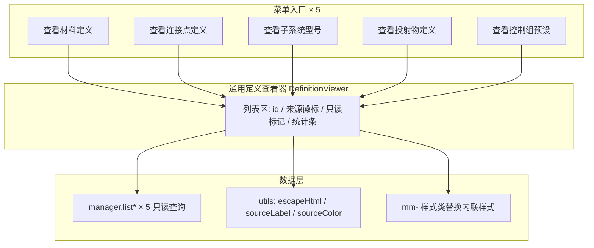

# MachineMax Blockbench 插件重构计划（P0–P4）

> 状态：**待审阅** · 日期：2026-08-09 · 范围：`src/` 前端插件（不含主模组）
> 目标版本：v0.4.0 之后的第一个重构批次

---

## 1. 背景与目标

插件经多轮迭代（2026-05-21 单日 20+ 提交，7 月又叠加导入等新功能），出现以下问题：

| # | 问题 | 现状 |
|---|------|------|
| A | 5 个"定义管理器"对话框交互风格各异 | 材料=select 流+死按钮；连接点=手输 ID；子系统=嵌套对话框；投射物/控制组=radio+详情。编辑功能**保存时静默丢失未覆盖字段**（数据丢失级 bug） |
| B | 信号输出目标编辑器三份重复实现 | SubsystemPanel / ConnectorPanel / InteractBoxPanel 各一份，细节已分叉；channelHints 三处漂移 |
| C | locator 选取两种 UI 范式 | 子系统面板=select 限定范围；连接点面板=input+datalist 自由文本 |
| D | 子系统类型数据源三处并存 | subsystem_types.js（真源，22 类）／manager 硬编码 22 个 ID（注释写 20）／对话框硬编码 19 个中文名（漏 3 类，已实际显示原始 ID） |
| E | 工具函数散落重复 | `_escapeHtml` ×4、来源映射逻辑 ×4（命名不一：`_sourceLabel`/`_getSourceLabel`/内联，颜色映射不一致；connector_dialog 无转义）、`stripJsonComments` ×2（独立实现）、对话框内联样式不统一 |
| F | 大型单体文件 | App.vue.js 1728 行、menu.js 981 行、pack_setup_dialog.js 825 行等；计算属性内高频 `log.info` |

**目标**：修复数据安全缺陷 → 统一"定义查看"体验 → 消除最大重复源 → 收敛数据源 → 清理工程债。全程保持功能不回归、不改变导出格式。

---

## 2. 已确认决策

1. **三个 CRUD 对话框（材料 / 连接点 / 子系统定义）砍成只读**。内容定义本质是内容包 JSON 文件，可由作者直接编辑；对话框仅提供查看。
2. **定义查看器仅展示"有哪些定义可用"**：列表区展示 id / 来源徽标 / 只读标记，**不做详情渲染、不做 JSON 预览、不注册渲染器**。内容包 JSON 由作者直接编辑，查看器不承担内容展示职责。
3. 面板层的**实例编辑**（子系统实例、连接点实例的信号/属性编辑）不在本次砍除范围，只做去重（P2）。
4. 5 个 manager 中，material/connector/subsystem 的 CRUD 方法**仅被各自对话框引用**（已 grep 确认），砍成只读后一并删除，避免死代码；`material_manager.getDefaultMaterialId` 无任何调用点，一并删除。
5. **App.vue.js 豁免于大文件拆分**（P4）：只做日志降级与纯函数抽取，不拆文件，豁免于"无 >800 行文件"验收。
6. **locator 统一为"输入框 + datalist 提示 + 自由文本"**：不改为 select；输入值不在可选范围内时仅做红/黄视觉标记（无效/未找到），不拦截输入。

---

## 3. 核心设计：通用只读定义查看器（P0/P1 的载体）

**组件规格**：

- 新建 `src/ui/components/definition_viewer.js`（或 `src/ui/dialogs/common/`），导出 `showDefinitionViewer(options)`。
- `options`：`{ title, width, height, items: [{id, data, source, editable}] }`。
- 列表区：ID、来源徽标（内置/依赖/当前三色）、只读标记，顶部统计条（来源分布计数），风格沿用现有 `mm-` 类（徽标等缺失类补充到 [mm_mode.css](file:///d:/Files/Project_MinecraftMods/Machine-Max_BlockbenchPlugin/src/styles/mm_mode.css)）。
- **无详情区、无 JSON 预览、无渲染器注册表**——查看器职责仅为"展示有哪些定义可用"；查看与编辑内容交给作者直接操作内容包 JSON 文件。

---

## 4. 阶段分解

> 每阶段独立可交付、可回滚；顺序执行，后阶段依赖前阶段产物。

### P0 — 止血：砍掉坏掉的定义编辑（数据安全）

**目标**：消除"编辑保存丢字段"的数据丢失 bug，移除死按钮与无人使用的 CRUD 代码。

**任务清单**：

1. [material_dialog.js](file:///d:/Files/Project_MinecraftMods/Machine-Max_BlockbenchPlugin/src/ui/dialogs/material_dialog.js)：删除创建/编辑/删除表单与流程，删除无事件绑定的死按钮（`mm_mat_edit`/`mm_mat_delete`），改为列表 + 只读查看（仅展示可用定义，不展示 JSON 内容）。
2. [connector_dialog.js](file:///d:/Files/Project_MinecraftMods/Machine-Max_BlockbenchPlugin/src/ui/dialogs/connector_dialog.js)：删除手输 ID 编辑流与编辑表单（6 字段版），改为列表 + 只读查看。
3. [subsystem_dialog.js](file:///d:/Files/Project_MinecraftMods/Machine-Max_BlockbenchPlugin/src/ui/dialogs/subsystem_dialog.js)：删除 create/edit/delete 嵌套对话框，改为列表 + 只读查看；删除硬编码 `_getTypeDisplayName`（19 条）——显示名改走 `subsystem_types.js`（此项同时消除问题 D 的一处；UI 显示名由 `引擎 (Engine)` 变为 `subsystem_types.js` 的 `displayName`（如 `发动机`），属预期显示变化）。
4. 删除 manager 层 CRUD（引用已确认仅来自上述对话框）：
   - [material_manager.js](file:///d:/Files/Project_MinecraftMods/Machine-Max_BlockbenchPlugin/src/managers/material_manager.js)：删 `createMaterial`/`updateMaterial`/`deleteMaterial`/`getDefaultMaterialId`（无引用）。
   - [connector_manager.js](file:///d:/Files/Project_MinecraftMods/Machine-Max_BlockbenchPlugin/src/managers/connector_manager.js)：删 `createConnector`/`updateConnector`/`deleteConnector`/`getConnectorTypes`/`getConnectorDirections`。
   - [subsystem_manager.js](file:///d:/Files/Project_MinecraftMods/Machine-Max_BlockbenchPlugin/src/managers/subsystem_manager.js)：删 `createSubsystem`/`updateSubsystem`/`deleteSubsystem`/`getSubsystemTypes`/`getTypeFields`（后者由 subsystem_types.js 取代）。
5. 对话框内补充提示文案："定义文件位于内容包 {type}/ 目录，可直接编辑 JSON"。
6. [menu.js](file:///d:/Files/Project_MinecraftMods/Machine-Max_BlockbenchPlugin/src/ui/menu.js)：菜单项改名（"创建/管理材料类型"→"查看材料定义"等）。

**不动**：content_pack.js 的 `writeDef`/`deleteDef`（P4 再评估清理）；App.vue.js 面板层的实例编辑。

**验收**：三个入口打开后无任何创建/编辑/删除入口、无详情区；保存操作不再存在（无丢字段路径）；grep 确认 CRUD 方法调用点清零；`npm run build` 通过；Blockbench 冒烟：三入口可查看定义列表、来源徽标正确。

**风险**：低。纯删除与降级为只读，无逻辑新增。

---

### P1 — 统一：通用定义查看器（纯列表）

**目标**：5 个入口视觉与交互统一为同一列表组件，消灭内联样式与工具函数重复。

**任务清单**：

1. 新增 `src/ui/components/definition_viewer.js`（规格见 §3，纯列表版：列表区 + 统计条，无详情区/渲染器注册表）。
2. 5 个对话框（material/connector/subsystem/projectile/control_group）全部改为调用 `showDefinitionViewer`；删除各文件内列表 HTML 构建函数与详情渲染函数（projectile/control_group 的 radio+setTimeout 绑定随之删除；connector 的 `DIRECTION_LABELS` 等展示映射一并删除）。
3. 抽取共用工具 `src/utils/html.js`：`escapeHtml` / `sourceLabel` / `sourceColor` / 来源统计；删除 4 份 `_escapeHtml`、4 份来源映射逻辑（含颜色映射差异）；connector_dialog 当前拼 HTML 无转义（潜在 XSS），统一转义顺带修复。
4. 列表与徽标样式改用 `mm-` 类（[mm_mode.css](file:///d:/Files/Project_MinecraftMods/Machine-Max_BlockbenchPlugin/src/styles/mm_mode.css) 已有 `mm-select`/`mm-input`/`mm-btn`，补充 `mm-badge` 等徽标类），替代硬编码内联样式。

**验收**：5 个菜单入口打开同一风格列表组件；无重复 `_escapeHtml`/来源映射逻辑；来源徽标三色一致；列表可滚动；含特殊字符 ID 正常显示（统一转义）；`npm run build` 通过。

**风险**：低（纯 UI 收敛，无详情渲染，改动仅限 5 个对话框的列表展示与共用工具抽取）。

---

### P2 — 去重：共享编辑器组件（面板层）

**目标**：消除信号编辑器三份重复、channelHints 漂移、locator 两种范式。

**任务清单**：

1. 新增 `src/ui/components/SignalTargetEditor.vue.js`：props `{ entries, targetOptions, channelHints }`，emit `change(entries)`；内部实现 channel 增删改、target 增删改、过滤去重逻辑。
2. [SubsystemPanel.vue.js](file:///d:/Files/Project_MinecraftMods/Machine-Max_BlockbenchPlugin/src/ui/SubsystemPanel.vue.js) / [ConnectorPanel.vue.js](file:///d:/Files/Project_MinecraftMods/Machine-Max_BlockbenchPlugin/src/ui/ConnectorPanel.vue.js) / [InteractBoxPanel.vue.js](file:///d:/Files/Project_MinecraftMods/Machine-Max_BlockbenchPlugin/src/ui/InteractBoxPanel.vue.js) 三处 signal_targets 编辑替换为该组件（SubsystemPanel 需保留按 field 参数化能力）。
3. channelHints 收敛：在 [constants.js](file:///d:/Files/Project_MinecraftMods/Machine-Max_BlockbenchPlugin/src/core/constants.js) 增加 `SIGNAL_CHANNEL_HINTS` 常量（合并三处差异，取并集），三面板引用之。
4. 新增 `LocatorPicker` 组件（`<input list>` 自由文本 + datalist 提示，props `{ options, value }`，emit `change`）：子系统面板传 `ownedLocatorNames`（范围不变），连接点面板传 `allLocatorNames`（范围不变）——统一**交互形态**为"输入框 + datalist + 自由文本"；输入值不在 `options` 中时以红/黄渲染标记（无效/未找到 locator），**不拦截输入**（保留自由文本搜索/引用越界 locator 的场景）。
5. [App.vue.js](file:///d:/Files/Project_MinecraftMods/Machine-Max_BlockbenchPlugin/src/ui/App.vue.js) 三个重复计算属性（`currentSignalTargetOptions` / `connectorParentSignalTargetHints` / `interactBoxParentSignalTargetHints`）收敛为单一方法 `signalTargetOptionsFor(spKey)`。

**验收**：三处面板信号编辑交互一致；channelHints 单一来源；locator 均为"输入框 + datalist"交互、自由文本可输入、不存在的值标红/黄且各自可选范围正确；子系统/连接点实例编辑功能无回归（增删改、过滤去重行为与原先一致）。

**风险**：中。Vue 2 响应式陷阱（必须 `$set`，组件内用 emit 深拷贝值，沿用现有约定）。

---

### P3 — 收敛：真源唯一化

**目标**：子系统类型数据源唯一，消除硬编码。

**任务清单**：

1. 确认 P0 已删除 `subsystem_manager.getSubsystemTypes`/`getTypeFields` 后，全项目引用统一指向 [subsystem_types.js](file:///d:/Files/Project_MinecraftMods/Machine-Max_BlockbenchPlugin/src/core/subsystem_types.js)（`getAllTypes`/`getTypeMeta`/`getDynamicFields`）。
2. 检查 `subsystem_generator.js` 对 `getTypeSpecificFields` 的转发导出（[L56](file:///d:/Files/Project_MinecraftMods/Machine-Max_BlockbenchPlugin/src/generators/subsystem_generator.js#L56)）：无引用则删除，引用方直接 require subsystem_types.js；[subsystem_manager.js](file:///d:/Files/Project_MinecraftMods/Machine-Max_BlockbenchPlugin/src/managers/subsystem_manager.js#L23) 中对该转发导出的 import 一并删除。
3. 5 个 manager 错误处理约定统一：P0 后全部为只读查询，无 throw/返回值分叉；确认无残留。
4. grep 兜底：无 `machine_max:engine` 等硬编码类型 ID 出现在 manager/对话框（subsystem_types.js 与 add_subsystem_dialog 除外）。

**验收**：`grep -r "getSubsystemTypes\|_getTypeDisplayName\|getTypeFields" src/` 无结果；新增子系统类型只需改 subsystem_types.js 一处。

**风险**：低。

---

### P4 — 工程债：大文件拆分与日志降噪

**目标**：可维护性提升，消除单体文件与高频日志。

**任务清单**：

1. [menu.js](file:///d:/Files/Project_MinecraftMods/Machine-Max_BlockbenchPlugin/src/ui/menu.js)（981 行）拆分：
   - `menu.js`：菜单注册与入口；
   - `export/export_pipeline.js`：`_executeExport` + schema 注入 + 目录结构（[L734-L959](file:///d:/Files/Project_MinecraftMods/Machine-Max_BlockbenchPlugin/src/ui/menu.js#L734-L959)）；
   - `export/export_dialog.js`：`_showExportDialog` + `_showPackSettingsDialog` + 依赖文本解析。
2. [App.vue.js](file:///d:/Files/Project_MinecraftMods/Machine-Max_BlockbenchPlugin/src/ui/App.vue.js)（1728 行，**豁免拆分**）：
   - 计算属性中的 `log.info` 高频调用（`availableSubsystemDefs`/`availableConnectorDefs`/`availableProjectileTypes` 等每次重算打日志）降级为 `log.debug` 或删除；
   - 信号目标选项等纯计算逻辑抽到 `src/utils/` 纯函数（P2 已收敛的 `signalTargetOptionsFor` 落地于此）；
   - **不做文件拆分**，豁免于"无 >800 行文件"验收。
3. [pack_setup_dialog.js](file:///d:/Files/Project_MinecraftMods/Machine-Max_BlockbenchPlugin/src/ui/dialogs/pack_setup_dialog.js)（825 行）按职责拆（创建/打开/依赖编辑器）。
4. `stripJsonComments` 两处合并：[builtin_pack.js](file:///d:/Files/Project_MinecraftMods/Machine-Max_BlockbenchPlugin/src/core/builtin_pack.js) 改引用 [file_writer.js](file:///d:/Files/Project_MinecraftMods/Machine-Max_BlockbenchPlugin/src/utils/file_writer.js) 版本，删除重复实现。
5. 评估 `content_pack.writeDef`/`deleteDef`（P0 后无调用方）：无引用则删除。
6. [element_markers.js](file:///d:/Files/Project_MinecraftMods/Machine-Max_BlockbenchPlugin/src/core/element_markers.js)（710 行）/ [patches.js](file:///d:/Files/Project_MinecraftMods/Machine-Max_BlockbenchPlugin/src/mode/patches.js)（634 行）：仅评估，若拆分风险高则保留（本项目无自动化测试，猴子补丁拆分的回归风险最大）。
7. **豁免清单**：`App.vue.js`（1728 行，见任务 2）/ `element_markers.js` / `patches.js` 豁免于"无 >800 行文件"验收。

**验收**：无 >800 行文件（豁免项除外：`App.vue.js` / `element_markers.js` / `patches.js`）；`npm run build` 通过；导出功能全流程冒烟（导出对话框→目录结构→文件内容与重构前一致）；面板高频操作无日志刷屏。

**风险**：中高（menu.js/pack_setup_dialog.js 改动大）。拆分期间保持行为等价，不顺手改逻辑。

---

## 5. 实施顺序与依赖

- **P0 与 P1 可合并实施**：P0 的"改为只读"直接以纯列表查看器落地（无详情渲染、无临时 UI），避免中间态重复劳动。若分批审阅，P0 先行交付止血。
- P2 依赖 P1 的 utils（escapeHtml 等）已收敛；技术上也可先做，但顺序上保持 P1→P2。
- P3 依赖 P0 的删除动作。
- P4 最后，纯工程债，不影响功能。

---

## 6. 冒烟测试清单（无自动化测试，人工执行）

每次阶段交付后执行：

1. `npm run build` 无报错。
2. Blockbench 加载插件：进入零件定义模式，创建/打开内容包。
3. **P0/P1**：5 个菜单入口逐一打开，确认统一列表样式、来源徽标、只读标记；确认无编辑/删除/创建按钮残留、无详情区/JSON 预览。
4. **P2**：添加子系统实例 → 编辑 signal_targets（增删改频道/目标/过滤去重）；连接点实例与交互区同理；locator 输入不存在的名称应标红/黄、自由文本不被拦截。
5. **P3**：新增子系统类型场景（如需验证）只改 subsystem_types.js。
6. **P4**：导出内容包 → 目录结构与文件内容与重构前一致（重点：meta.json、parts、connectors、subsystems、materials、lang）。

---

## 7. 非目标（明确不做）

- 不修改 codec 框架（[Codec.js](file:///d:/Files/Project_MinecraftMods/Machine-Max_BlockbenchPlugin/src/codec/Codec.js) 设计良好，保持不动）。
- 不重写 signal_graph 力导向布局 / SignalFlowPanel 可视化。
- 不实现任何新的定义编辑能力；定义查看器仅列表展示（不展示 JSON 内容、不预留渲染器扩展点），编辑留待未来。
- 不引入 TypeScript、新框架或改构建工具。
- 不改变数据模型与导出 JSON 格式（兼容已发布内容包）。
- 不补测试基建（bun test 目录恢复列为后续独立任务，不在本次范围）。

---

## 8. 决策记录

| 日期 | 决策 | 说明 |
|------|------|------|
| 2026-08-09 | 三个定义 CRUD 对话框砍成只读 | 编辑表单追不上 schema 演进，已两次删字段导致丢数据；内容包 JSON 可外部编辑 |
| 2026-08-09 | 定义查看器砍到纯列表（无详情/JSON 预览） | 现有编辑器不值得保留也不重写；查看器仅展示"有哪些定义可用"，内容查看/编辑交给 JSON |
| 2026-08-09 | locator 统一为输入框+datalist+自由文本 | 自由文本用于搜索/越界引用，不存在时标红/黄，不改为 select、不拦截输入 |
| 2026-08-09 | App.vue.js 豁免大文件拆分 | 仅日志降级与纯函数抽取，豁免"无 >800 行文件"验收 |
| 2026-08-09 | manager CRUD 方法直接删除而非保留 | 已确认仅被对应对话框引用，保留即死代码 |
